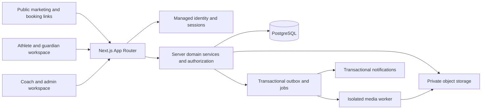

# Coach Tae QB LAB — repository audit and implementation plan

Status: **proposal for owner review; no platform implementation or deployment authorized by this document.**

Audit date: October 22, 2026. Repository: `taenextlevelqbs-ops/coach-tae-website`. Baseline: `b502819d9fa226421f793217cf325b9801cdf95c`, local branch `work`. Scope: all tracked source, configuration, documentation, asset inventory, installed dependencies, local runtime, and read-only attempts to access both supplied public URLs. No production changes, purchases, payment activation, or booking changes were made.

## 1. Recommendation and scope

Keep the current marketing page and its booking links intact. Add QB LAB as a separate application area in the existing Next.js repository. Start with a small, real, invitation-only film review service: parent-managed athlete profiles, consent, private uploads, assigned coach review, written timestamped feedback, drill assignments, status tracking, and parent-visible notifications. Provide a reviewed introductory learning unit for **both tackle and flag** in the pilot. This tests the coaching business and the most sensitive technical workflow before investing in large content libraries, playbook editing, subscriptions, or 3D animation.

MVP means a complete secure coaching loop, not a simulated dashboard. It excludes payments, public sharing, AI evaluation, team subscriptions, a full play editor, and customizable animated athletes. Advanced film tools follow the basic coaching loop before broad commercial launch. Pilot limitations must be explicit; do not advertise deferred features as available.

Use a modular monolith, PostgreSQL, managed authentication, private object storage, and a small asynchronous media pipeline. Keep provider interfaces narrow so storage, identity, and email can change without rewriting the learning model. Provider selection and spending require owner approval. No additional dependency or service has been installed for this proposal.

## 2. Existing repository audit

### 2.1 Architecture and integrations

| Area | Evidence and finding | Consequence |
| --- | --- | --- |
| Framework | `package.json`: Next.js 16.3.3, React/React DOM 19.2.8; TypeScript 5; Tailwind CSS 4; ESLint 9 | Retain App Router and server rendering; read the installed Next.js guides before implementation, as required by `AGENTS.md`. |
| Pages | `app/page.tsx` is an 813-line server component; `app/layout.tsx` owns metadata; no other application page routes | Single marketing page, not an existing academy platform. Split future domain modules without redesigning this page first. |
| Interaction | `app/SiteNav.tsx` is the only explicit client component; menu state, Escape handling, focus return | Reuse its branding and keyboard patterns; introduce separate authenticated navigation. |
| Server/API | No route handlers, Server Actions, custom server, middleware/proxy, background jobs, or integrations in tracked source | All identity, authorization, persistence, video, and notification capabilities are new work. |
| Storage/accounts | No database schema, ORM, auth provider, sessions, account routes, or athlete records | There is no existing user-data migration; do not infer that external service customer records are available. |
| Booking | Calendly links for individual and group training, repeated in page and navigation | Preserve exact destinations: `https://calendly.com/taenextlevelqbs/individual-training-clone` and `https://calendly.com/taenextlevelqbs/group-training`. There is no embedded booking API or webhook. |
| Commerce | Links to `https://dmvattack.myshopify.com/`; DMV Attack link to `https://dmvattack.com` | No local checkout, payment SDK, subscriptions, or fulfillment integration. External commerce remains independent. |
| Configuration | Empty `next.config.ts`; strict `tsconfig.json`; npm lockfile; no runtime environment lookups in source | Current website runs without secrets or a database. Future config must be validated server-side. |
| Hosting | User supplied production and Vercel URLs; README references Vercel; no `vercel.json`, IaC, or CI workflow tracked | Actual project linkage, regions, headers, deployment permissions, DNS, and environment protection remain unverified. |
| Container | `Dockerfile`: Node 22 Alpine, `npm install`, starts `npm run dev`; `.dockerignore` is empty | Not a production-ready container recipe. Plan a frozen install, multistage production build, non-root runtime, and exclusions for `.git`, `.env*`, caches, and local output. Do not ship the development server. |
| Tooling | Scripts: dev/build/start/lint; no test script or test suite; no Node version file or engines pin | Add meaningful tests and align local, CI, and hosting Node versions in a separate approved implementation change. Current cloud validation used Node 24.19.0/npm 11.9.0. |
| Documentation | `AGENTS.md` requires consulting bundled Next.js docs; `CLAUDE.md` references it; README is create-next-app boilerplate | README incorrectly describes active Geist font loading: layout imports no `next/font`; body uses Arial/Helvetica. Add real developer documentation later. |

### 2.2 Current user experience and reusable assets

The page contains hero branding, training offerings, coach biography/career statistics, DMV Attack 7v7, foundation, apparel, and booking/footer sections. Navigation anchors target `training`, `about`, `attack`, `foundation`, and `apparel`; a skip link targets `main-content`. Local HTML inspection found no broken internal anchor targets, 13 image elements, the expected title, and nine Calendly anchors. Listed prices are $60 group, $85 private, and $240 for three individual sessions; these are existing marketing statements, not verified current inventory or QB LAB pricing. Career statistics and biography are existing copy, not independently validated facts.

Brand assets include the Coach Tae and DMV Attack logos and training/team photography. Black backgrounds, white type, restrained sky accents, bold athletic headings, rounded panels, and photography provide a sound visual starting point. `next/image` supplies local optimized images, explicit dimensions/sizes, and hero preload. The hero original is roughly 1.2 MB; other JPEGs range from tens to hundreds of KB. Retain originals and measure actual optimized delivery before changing assets. Confirm rights and consent for any identifiable athletes before reusing photography in new contexts.

Reuse: logo/brand treatment, responsive container patterns, focus outline, skip link, reduced-motion CSS, image handling, and external booking actions. Extract shared design tokens and small cards/buttons during implementation; avoid making the marketing page a dependency of private dashboards. Booking constants are duplicated between page and navigation and could drift; centralize only with regression coverage. The static three-session package display is informational and has no dedicated purchase control.

### 2.3 Accessibility, mobile, and performance findings

- Existing strengths: semantic navigation labels; one intended main landmark; descriptive image alternatives; menu `aria-expanded`/`aria-controls`; hidden closed panel; Escape closes and returns focus; visible keyboard focus; reduced-motion handling; new-tab notices; external links use `noopener noreferrer`.
- Responsive intent: Tailwind grids and typography; menu breakpoint at 980 px; smaller brand treatment at 600 px; fixed mobile booking bar with safe-area padding and bottom content spacing; minimum body width 320 px. The hero still contains a 650 px inner minimum height, so small-screen content height needs visual review. The foundation/apparel anchor containers are `div` elements, while custom scroll-margin CSS targets `section[id]`; verify anchor visibility below the sticky header.
- Likely accessibility risks: many 7–10 px labels and translucent white text; contrast over photographs and low-opacity text require measured checks. Do not treat ESLint as WCAG certification. Verify 200%/400% zoom, visible focus not obscured by fixed bars, landscape, screen-reader order, and mobile menu behavior during resize.
- Keep private pages lean: load annotation/editor code only on the relevant route; never load video assets on the marketing homepage. Use poster images and explicit dimensions; prevent automatic video playback. Track real-user performance only after privacy review.
- Proposed performance gates: public routes meet p75 LCP ≤2.5 s, INP ≤200 ms, CLS ≤0.1 on representative mobile traffic; staging lab tests are a baseline, not proof of field performance. Agree a device/network and concurrent-user target before claiming capacity.

### 2.4 Security findings and priorities

`npm audit --omit=dev --json` reported **four affected production dependency entries: one critical and three high**, not four independently proven exploitable application defects. Its underlying command returned nonzero; a later report-formatting command completed successfully. No automatic fixes were run.

| Finding | Registry advisory evidence | Assessment and next action |
| --- | --- | --- |
| Next.js critical | [GHSA-vcvr-r3jv-pc5j](https://github.com/advisories/GHSA-vcvr-r3jv-pc5j), ImageResponse RCE; registry range ≥16.2.0, <16.3.6 | Installed 16.3.3 is in reported range. No `ImageResponse` use found; metadata images are static JPEGs. Evaluate applicability, then upgrade Next.js and aligned eslint-config-next in a dedicated hardening PR. |
| Next.js additional advisories | [GHSA-cjq9-62q9-8jv4](https://github.com/advisories/GHSA-cjq9-62q9-8jv4) image optimization SSRF; cache, draft, development MCP and metadata-route advisories in registry report | Current local images reduce some exposure but do not establish immunity. Several reported fixed ranges begin at 16.3.8; recheck vendor guidance and the complete current audit before choosing versions. |
| sharp high | [GHSA-wq5f-xc86-pv6w](https://github.com/advisories/GHSA-wq5f-xc86-pv6w), librsvg issue, reported range <0.35.5 | Private media uploads expand image-processing risk. Verify patched dependency resolution and handling of untrusted thumbnails. |
| source-map-js high; postcss high via dependency | [GHSA-68fv-2mgg-jv7q](https://github.com/advisories/GHSA-68fv-2mgg-jv7q), indexed source-map denial of service, reported range ≥1.0.0, <1.2.2 | Determine build/runtime exposure and update supported dependency chain. Avoid speculative override changes. |

Registry metadata is a point-in-time result; advisory authenticity, current patches, and deployment applicability must be verified against vendor guidance in the hardening work. Do not equate a passing build with security readiness. Include dev dependencies in the later full supply-chain review.

No CSP, explicit security headers, rate limiting, or privacy/account policies are defined in application source. Hosting may supply some headers; production headers were **not observed**. No tracked credential files or secret-like integration configuration were found in the inspected inventory; this is not a full history/secret scan. Current public assets are intentionally public and are **not suitable for private athlete uploads**. Development server exposure must remain within the development environment.

Before any private athlete data: patch and review dependencies, enable staff MFA, enforce object-level authorization, isolate private storage, approve consent/privacy/deletion policy, and test backups and deletion. Do not add a database service key to a browser bundle or use public object URLs for film.

### 2.5 Evidence, limits, and branch strategy

Verified in this cloud instance at the baseline: frozen `npm ci`, production build (including TypeScript and static generation), lint, homepage HTTP/content, and local logo response passed during onboarding. Lint and homepage anchor checks passed again for this audit. No test suite exists. Browser/mobile observations are recorded in the validation appendix below. Local success does not prove deployed parity.

Read-only GET attempts to `https://coachtaeqb.com/` and `https://coach-tae-website.vercel.app/` failed at the environment proxy with `Tunnel connection failed: 403 Forbidden`. This is an egress restriction, not evidence that either website is down or misconfigured. Deployed appearance, headers, analytics, bookings completing successfully, web vitals, and Vercel settings remain unverified. No booking was submitted and no purchase was made.

Recommended workflow: protect `main`, use short-lived branches such as `docs/qb-lab-plan`, `chore/security-baseline`, `feat/lab-identity`, and `feat/film-submission`; one reviewable capability per PR. Do not maintain a long-lived platform branch. Require CI, review, staging acceptance, and explicit production deployment approval. Use reversible server-side feature flags and additive migrations; keep unfinished routes unavailable to customers. This document is left on the existing `work` checkout; no branch switch, push, or deployment was performed. Existing cloud tasks are isolated; no extra worktree is needed.

## 3. Target architecture and boundaries

Keep Server Components for page data and isolate client code for upload progress, playback, quizzes, and the editor. Use Route Handlers for upload intents, playback grants, webhooks, exports, and jobs; use Server Actions where useful for first-party forms, with the same validation and authorization as API endpoints. The server owns authorization, scoring, quotas, entitlement checks, and state transitions. Hidden UI is never an access-control mechanism. Follow bundled Next.js authentication, caching, and route-handler guidance before implementing.

Suggested folders: `app/(marketing)` for the existing site; `app/(lab)/lab` for authenticated pages; `app/(coach)/coach`; `app/api`; `modules/{identity,consent,film,learning,playbook,billing}`; `lib/{db,auth,storage,validation}`. Route groups must not duplicate URL paths. Services return minimal DTOs, not full DB rows. Mark privileged modules server-only. Do not cache user-specific responses globally; media and profile responses use private/no-store behavior and signed URLs never enter static metadata.

**Provider decision:** PostgreSQL plus a managed identity/storage option such as Supabase is a reasonable candidate, with server-mediated authorization and database row-level policies as defense in depth. Compare with a supported auth library plus managed PostgreSQL and S3-compatible private storage before commitment. Verify minors' data terms, region, deletion guarantees, signed playback, backups, MFA, export, pricing, and Next.js compatibility. Start without Redis, microservices, a paid analytics SDK, or a separate CMS. Add a durable job runner only where reliable media processing requires it. Never run long ffmpeg processing inside a request-bound serverless function; use an isolated worker or approved media service. Use open-source ffmpeg only with codec/license review and a sandboxed resource budget.

Separate local, staging, and production identities, databases, storage buckets, webhook secrets, and email destinations. Staging uses synthetic or consented test data, protected previews, and no production database credentials. Versioned SQL migrations and seed data live in Git once implementation begins. Expand/contract migrations keep the previous app compatible; rollback does not mean dropping athlete records. Restore backups into an isolated environment and measure recovery objectives before launch.

## 4. Navigation and routes

These routes are proposals; none are implemented by this plan.

| Audience | Routes | Purpose/access |
| --- | --- | --- |
| Public | `/`, `/qb-lab`, `/qb-lab/tackle`, `/qb-lab/flag`, `/privacy`, `/terms`, `/accessibility` | Preserve home anchors/bookings; explain real available offerings. No private athlete profiles or media indexed. |
| Identity | `/sign-in`, `/sign-up`, `/auth/callback`, `/onboarding`, `/consent` | Parent/adult onboarding and verified invitations; safe redirect allowlist. |
| Athlete | `/lab`, `/lab/academy`, `/lab/academy/[pathway]`, `/lab/lessons/[id]`, `/lab/iq/[id]`, `/lab/training`, `/lab/progress` | Selected athlete context, assignments, reviewed learning and actual activity. |
| Film | `/lab/film`, `/lab/film/new`, `/lab/film/[id]`, later `/lab/film/compare` | Upload/status, released feedback, consent-aware playback. |
| Playbooks | `/lab/playbooks`, `/lab/playbooks/[id]`, `/lab/playbooks/[id]/edit` | Assigned/read-only versus owned/editable play versions. |
| Guardian | `/family`, `/family/athletes/[id]`, `/family/consents`, `/family/billing`, `/family/data` | Manage linked children, visible feedback, purchases when approved, export/deletion. |
| Coach | `/coach`, `/coach/athletes/[id]`, `/coach/reviews/[id]`, `/coach/programs`, `/coach/content`, `/coach/playbooks` | Assigned roster/review queue and approved authoring permissions. |
| Admin | `/admin/access`, `/admin/consent`, `/admin/audit`, `/admin/memberships`, `/admin/operations` | Least-privilege operational controls; business totals without blanket media access. |

Athlete navigation: Today, Academy, Film, Training, Playbooks, Progress. Parent navigation: Athletes, Feedback, Consent & Privacy, Account. Coach navigation: Review Queue, Athletes, Programs, Content. On mobile, show only available features, use a compact menu, and avoid overlap with marketing booking bars. Replace homepage-only `#training` style links with `/#training` when shared outside home. Preserve current home links until that extraction is approved.

Use explicit empty/loading/error/success states. Empty dashboards say “No sessions recorded” rather than inventing percentages. Show upload recovery, “saved” only after server confirmation, and disabled states with a reason. Confirm destructive actions. No public leaderboards of children or global skill rankings. Accessible animation includes pause/replay, reduced motion, keyboard alternatives, transcripts/captions, and a textual explanation of each diagram.

## 5. Athlete, guardian, and authorization model

Separate an authenticated human account from an athlete profile. One guardian can manage several athletes; an athlete can have multiple verified guardians. Adult athletes may own their profile. Do not require a child email or permit self-declared age to bypass consent. For the pilot, use guardian-created minor profiles and guardian-managed access; whether older minors receive independent logins is an explicit later decision. Guardianship disputes require a documented support process, not automatic linkage by matching surnames or email claims.

Age bands: 8–10, 11–13, 14–15, 16–18, college. **College is a development context, not proof of adulthood; an 18-year-old may still be in high school.** Determine legal minor status independently using the applicable jurisdiction and verified account information. Minimize birth-date collection; if exact DOB is legally necessary, restrict it and expose only computed bands. Experience placement (introductory, developing, advanced) is separate from age, chosen from a coach-reviewed diagnostic and revisable by a coach. Maintain separate pathway enrollments; a player can study both.

| Role | Permitted scope | Prohibited by default |
| --- | --- | --- |
| Athlete | Own assigned content, own recordings and released feedback with active consent | Other athletes, coach drafts, billing secrets, own privilege changes |
| Guardian | Verified linked athletes, their consent/data requests, released coaching communication | Unlinked profiles, silent association takeover, staff tools |
| Coach | Explicitly assigned athletes and permitted content authoring | Unassigned videos, membership administration, guardian approval impersonation |
| Content reviewer | Draft curriculum and test fixtures | Athlete film unless separately assigned |
| Business admin | Entitlements and aggregate business activity | Automatic unrestricted access to private film |
| Security admin | Audited role/invite operations and narrowly scoped support access | Unlogged bulk browsing or exporting |
| Worker | Specific processing jobs and object prefixes | Interactive user sessions or full account administration |

Every request combines identity, organization membership, profile ownership/assignment, consent state, resource state, and entitlement where relevant. Derive organization and athlete IDs from authorized server context, not trusted browser claims. Use deny-by-default checks for list queries, individual resources, joins, exports, thumbnails, playback URLs, and notification links. Staff MFA, short-lived invites, secure HttpOnly/Secure/SameSite cookies, session rotation, CSRF/origin protections, rate limits, and account recovery controls are required. Audit privilege changes and unusual media access without logging signed URLs or video contents.

Before collecting children's data, obtain legal review for applicable children's privacy and consent obligations (including COPPA where applicable), operator/vendor responsibilities, verified parental consent method, and guardian-visible communications. A checkbox alone is not assumed sufficient. Record consent version, scope, verification evidence reference, actor, timestamp, revocation, and jurisdiction basis; keep sensitive evidence out of ordinary logs. Separate service consent from optional marketing/media release. Revocation immediately blocks new activity and future access grants; deletion follows the approved policy. Discuss the bounded residual lifetime of an already-issued signed URL with the owner; use very short TTLs or a revocable authorization gateway where immediate revocation is required.

## 6. Proposed relational schema

This is a logical schema, not an applied migration. UUID primary keys unless stated, UTC timestamps, explicit foreign keys, and versioned status constraints. Use `organization_id` on tenant-owned rows and composite foreign keys to prevent cross-organization references; initial organization is Coach Tae. No team feature is exposed in MVP. Identity provider subject is unique; never store provider passwords in this database. Add indexes for every authorization join and queue lookup.

| Entity | Main columns and relationships | Constraints/lifecycle |
| --- | --- | --- |
| `organizations`, `organization_memberships` | org name; org/user/role/status | Unique org/user/role; only privileged server operations grant roles. |
| `users` | auth_subject, display_name, email_verified_at, status | Unique auth subject; minimal account data; provider handles credential lifecycle. |
| `athletes` | org, display_name, age_band, birth_data_ref if required, minor_status, experience_level, development_context, adult_owner_user_id nullable | No public profile; adult ownership and guardian linkage checked server-side. |
| `guardian_links` | org, athlete, guardian_user, relationship, verification_status, verified_at | Unique athlete/guardian; only verified active links authorize access. |
| `athlete_logins`, `coach_assignments` | user/athlete/status; coach/athlete/start/end | Optional athlete login mapping; scoped active coach relationship, revocable immediately. |
| `consent_records` | athlete, guardian, scope, policy_version, verification_method, evidence_ref, granted_at, revoked_at | Append-only evidence history; active scope computed; legal retention separated from media retention. |
| `pathway_enrollments`, `placement_reviews` | athlete, tackle/flag, experience, ruleset_version; placement rationale/reviewer/date | Unique active enrollment per athlete/pathway; independent age and experience axes. |
| `rulesets`, `ruleset_versions` | organization/body, format, season, source_url, source_hash, effective dates, rule fields, reviewer | Immutable published versions; source/license and review status mandatory. |
| `lessons`, `lesson_versions`, `drills` | stable identity; pathway, age bands, experience, objectives, prerequisites, ruleset reference, content, reviewer, published_at | Published content immutable; no unreviewed content in athlete assignments. Drills include safety cues and modifications. |
| `programs`, `program_items`, `assignments` | ordered lessons/drills; athlete, assigner, item_version, due_at, status | Foreign keys pin exact content version; no polymorphic orphan IDs (use explicit typed FK/check). |
| `activity_events`, `lesson_progress`, `workout_sessions` | actor, athlete, type, source, idempotency_key, occurred_at; completion and session records | Unique event key per source; derived summaries rebuildable; distinguish self-report and coach verification. |
| `questions`, `question_versions`, `answer_options` | scenario, concept tags, pathway, ruleset_version, prompt, options, rationale, rubric, review provenance | Stable option IDs; answer keys server-only; published revisions immutable. |
| `quiz_attempts`, `quiz_responses` | athlete, quiz_version, question_version, chosen answer, server_score, start/submit timestamps | One response per attempt/question; bounded retries; responses reference the historical key version. |
| `media_assets`, `upload_sessions` | athlete, object key, purpose, MIME, bytes, checksum, duration, processing state, retention_due_at; upload reservation/expiry | Unique object key; no permanent public URL; uploaded metadata untrusted until worker verifies it. |
| `film_submissions`, `review_assignments` | athlete, source asset, pathway/ruleset, prompt, status/version; coach, assigned_at | Valid state transitions with optimistic locking; one active owner for queue work. |
| `film_reviews`, `annotations`, `review_drill_assignments` | submission, coach, draft/released revision; asset/version, timestamp_ms, geometry_json, text, voice_asset | Feedback distinguishes human/AI provenance; coordinates normalized and bounded; released revisions audited. |
| `comparisons` | athlete, before_asset, after_asset, alignment offsets, coach notes | Both assets belong to same authorized athlete; descriptive comparison, no invented improvement score. |
| `playbooks`, `plays`, `play_versions`, `play_assignments` | owner, visibility; field/ruleset version, players/routes/timeline JSON, schema_version; athlete/version | JSON schema validation plus relational ownership; shares pin immutable versions and explicit recipients. |
| `notifications`, `outbox_events`, `job_runs` | recipient, safe event type, resource ref; transaction ID, dedupe key, attempt, lease, next retry | Idempotent delivery, retry/dead-letter queue, parent visibility; no film or sensitive comments in email. |
| `products`, `price_mappings`, `subscriptions`, `purchases`, `entitlements`, `billing_events` | future provider IDs; org/family scope; athlete/product, quota, valid dates; webhook event ID | Unique provider event ID; no card data; entitlements remain independent of billing provider. |
| `audit_events`, `data_requests`, `deletion_jobs` | actor/action/resource/time; export/delete requester/verification/status; object manifest | Restricted append-only audit; minimize sensitive payload; deletion retriable with completion evidence. |

Additional constraints: positive file sizes/durations within configured limits, unique active assignment keys, checks for valid pathway/format, timestamp bounds within the correct media timeline, and tenant-consistent parent/child rows. Use transactions for consent transitions, submission creation plus quota reservation, review release plus notification outbox, and entitlement updates. Use optimistic `version` fields for editable drafts and queue claims. Index `(organization_id, athlete_id, created_at)`, active guardian/coach links, review `(status, assigned_coach, submitted_at)`, and jobs `(status, next_attempt_at)`.

Store media binary data in private storage, not PostgreSQL. Annotations/play paths are bounded JSON documents with versioned schemas, never executable SVG/HTML supplied by users. Deletion anonymizes or removes linked activity as policy requires; billing/legal evidence may need separate minimal retention. Do not cascade-delete consent evidence or financial records blindly. Exports must include only the authorized athlete and exclude staff-only notes and other athletes.

## 7. Film review: priority workflow

### 7.1 States and operations

Submission flow: `draft → uploading → processing → submitted → in_review → feedback_ready → archived`. Alternatives: upload `expired/cancelled`, processing `failed/quarantined`, coaching `changes_requested`, deletion `deletion_pending → deleted`. Technical processing state belongs to the media asset; coaching state belongs to the submission. A user-visible “processing” status can combine them but must not conflate failed processing with completed coaching.

1. Guardian/adult selects athlete, pathway, context and coaching question; server checks identity, linkage, consent, quota, file policy, and assignment availability. Explain framing, bystander privacy, allowed content, retention, and expected coaching turnaround before capture.
2. Create an expiring upload reservation and unique private object key. Upload directly to quarantined object storage through a scoped signed multipart/resumable capability; never buffer the whole video through Next.js. Proposed pilot limit: one clip per submission, ≤60 seconds and ≤100 MB, pending real-device/storage tests and owner approval. Support iPhone MOV/HEVC inputs through validated transcoding, not an assumption that every browser can play them.
3. Completion/webhook must be authenticated, idempotent, and bound to the reservation. Independently verify object size, signature/type, checksum where supported, duration, and actual codec. Reject mismatches; strip unnecessary location/device metadata. Malware checks complement, not replace, sandboxed decoding. Apply CPU/time/memory limits and quarantine failures.
4. An isolated worker creates normalized playback derivatives and thumbnails with a timeline mapping. Keep all derivatives private. Emit `media.ready` only after verification; transactionally submit into the coach queue. Expired uploads release reserved quotas and orphan objects are swept.
5. Assigned coach opens a queue item. Claim uses an atomic version check to prevent conflicting reviewers. Playback grant checks active assignment/consent for each request. Player supports play/pause, keyboard seeking, timestamps and safe speed changes. Browser seeking is approximate; label it as such until exact frame navigation is implemented using frame-aware derivatives/indexing and tested against variable frame rate inputs.
6. Coach saves draft timestamped comments and assigns reviewed drills. Autosave reports persisted version and handles conflicts. Draft feedback is visible only to authorized staff; guardians/athletes see released feedback. Staff notes require a defined policy and cannot become hidden direct messaging with minors.
7. Release validates feedback, records the human author/version, and writes notifications in the same transaction. Parent and athlete receive safe in-app alerts; email says feedback is available without embedding private content. Retries must not duplicate notifications.
8. Later tools add normalized-coordinate pen/arrows, voice recording with consent and transcript, exact frame controls, and before/after playback with manual alignment. Preserve source/derivative timeline relationships and annotation compatibility when reprocessing. Comparison does not claim measured skill gains.
9. Parent/adult can request export/deletion and see retention due dates. Revoke playback grants, stop pending processing, delete originals, renditions, voice, thumbnails and exports, clear CDN copies where applicable, and record a minimal deletion receipt. Backups age out under the approved schedule; restored backups must replay deletion tombstones. Verify provider behavior, including incomplete multipart uploads.

### 7.2 API contract outline

All paths are proposed `/api/v1` endpoints, server validated with shared schemas and stable error codes. Normal responses omit storage credentials and internal object keys except restricted upload capabilities.

| Endpoint | Contract and required guard |
| --- | --- |
| `POST /film/upload-intents` | athlete, filename/type/size hints, client request key → reservation, scoped upload instructions/expiry; consent + ownership + quota; filename never determines object path. |
| `POST /film/uploads/:id/complete` | reservation + verified completion reference → accepted/processing; ownership and idempotency; cannot assert “ready” from client. |
| `POST /webhooks/media` | signed event, replay protection and timestamp window → durable accepted event; worker validates asset. |
| `GET /film`, `GET /film/:id` | cursor-paginated scoped lists/detail; no cross-family enumeration; revoked/deleted media hidden. |
| `POST /film/:id/playback-grants` | asset purpose/version → short-lived authorized playback capability; audit and rate limit; never permanent public links. |
| `POST /coach/reviews/:id/claim` | expected version → exclusive assignment or conflict; active coach scope. |
| `PATCH /coach/reviews/:id` | versioned draft text/annotations/drill IDs → persisted revision; reject invalid times/geometry and unauthorized assets. |
| `POST /coach/reviews/:id/release` | expected revision + idempotency key → released revision/outbox; staff MFA and permission. |
| `POST /family/data-requests` | verified profile scope and export/delete type → tracked request; recent authentication and guardian authority. |

Return 401 for unauthenticated access, safe 403/404 behavior for unauthorized resources, 409 for stale writes, 413 for excess size, 422 for invalid content, and 429 with retry guidance for quotas/rates. Do not reveal another athlete's existence through error text. Test grant expiry, range requests and seeking, interrupted mobile uploads, retries after process restarts, callback forgery, and deleted-resource races.

## 8. Learning, football IQ, and training content

### 8.1 Curriculum and placement

Maintain equal editorial and test standards across pathways. The curriculum below is a scope map, not reviewed football instruction or an answer key.

| Band | Presentation and coaching approach | Placement controls |
| --- | --- | --- |
| 8–10 | Short guided lessons, simple vocabulary, visual cues, guardian help, low reading load | Experience diagnostic; no forced complex terminology or age-based skill score. |
| 11–13 | Basic concept combinations and guided explanation of choices | Independent advancement in each pathway. |
| 14–15 | More contextual reads, situational reasoning, preparation habits | Coach approves prerequisites and adjusts difficulty. |
| 16–18 | More complex rotations, progressions, clock/game context, film reflection | Account/consent status remains separate from content level. |
| College | Scheme-specific depth and detailed self/coach review | Institution and rule context explicit; college status does not imply expertise or legal adulthood. |

Tackle track scope: fundamentals, throwing mechanics, footwork/pocket movement, defensive coverage recognition, pre-/post-snap reads, route concepts/progressions, blitz identification, situational football, two-minute offense, strength/mobility/recovery. Flag track scope: fundamentals, explicitly selected 5v5/7v7 rules, formations and concepts, defensive coverage, defender/rusher reads, quick-release mechanics, passing progressions, playbooks, and situational decisions. Shared mechanics lessons may be reused only after a reviewer confirms the applicability and adaptations. Existing DMV Attack 7v7 branding does not establish a flag ruleset.

### 8.2 Football IQ content model and scoring

Each published question version includes: learning objective, pathway, ruleset version, age/experience suitability, formation/personnel, field geometry, clock/down/distance/score, pre-snap picture, post-snap timeline, progression/coaching assumptions, prompt, stable answer options, defensible rubric, explanation for each option, relevant evidence/source, reviewers, publication date, and accessibility description. Separate what the player can observe at decision time from later revealed motion. Flag missing scenario assumptions rather than inventing one correct response.

Workflow: `draft → football review → editorial/accessibility review → approved → published → retired`. A qualified tackle/flag reviewer signs off in the relevant context; disputed or ambiguous scenarios remain unpublished or become explicitly open-ended coach-reviewed exercises. Record source rights and media permission. AI may assist drafting only under later approval; human approval is required and AI suggestions never appear as Coach Tae feedback without attribution.

Server creates attempts, pins exact question/ruleset versions, validates selections, and computes rubric results. Do not send answer keys before submission. Scores mean performance on those reviewed questions, show numerator/denominator and context, and never imply real-world QB ability or injury/fitness assessment. Permit multiple defensible options or qualitative feedback where appropriate. Timing is optional and accommodated, not a proxy for intelligence. Recommendations initially use transparent prerequisite and error-topic rules, with coach override; no opaque prediction model. Show actual lesson completions, self-reported training, coach-reviewed drills, and quiz attempts separately. No fabricated improvement percentages or sample activity disguised as a real account.

### 8.3 Flag ruleset strategy

Do not ship a universal flag rules engine. Select one owner-approved league/body and season for the first 5v5 unit and separately validate any 7v7 format. Track source document/version, applicability, reviewer, effective dates, and licensing. Model player count, field dimensions, eligible positions, formation constraints, rushing/blitz eligibility and timing, QB movement/run restrictions, no-run zones, pass clock, contact rules, scoring, downs, and game clock as explicit versioned fields; unknown fields block rules-dependent assessments.

Rules differences must appear in the lesson header, field editor, quiz and saved play. A ruleset update creates a new version and reviewer-approved compatibility report; do not silently rescore old attempts or reinterpret saved plays. Use fixture tests derived from the selected official rules, including legal/illegal edge cases. Unsupported leagues can use a clearly marked illustrative sandbox only; it must not award rules-based correctness or claim legal plays.

### 8.4 Virtual training and customizable athlete

Start with coach-reviewed real demonstrations or carefully reviewed 2D assets for mechanics, footwork, pocket movement, shoulder warmups, core conditioning, mobility, recovery, and follow-along sessions. Each includes suitability, equipment, setup, coaching cues, common cautions, modifications, captions/transcript, reviewer and version. Have a qualified movement professional review conditioning and warmup material as appropriate; stop/pain guidance directs users to qualified care and does not diagnose.

Later, evaluate licensed rigged 3D assets and a browser renderer only after a small movement-accuracy prototype, device performance and accessibility review. Animation must preserve joint/ball timing, handedness, camera clarity, and coaching intent. Avatars can customize cosmetic traits and reward recorded participation; never present them as a biomechanical digital twin. Camera uploads do not automatically validate mechanics, estimate injury risk, or prescribe treatment. No streak pressure or monetized rewards targeted at children. Keep 3D bundles out of ordinary academy routes and provide equivalent video/text content.

## 9. Interactive playbook architecture

Build a deterministic 2D SVG editor first, using normalized field coordinates with units/field dimensions stored separately. Render route paths from validated points rather than user-supplied markup. Model player IDs/side/roles/start position, paths with timing, optional ball events, defensive alignments, labels, ruleset version and editor schema version. Tackle and each flag format have explicit roster constraints; do not infer all 7v7 rules from player count. Geometry validation can enforce a reviewed formation constraint but cannot prove a play succeeds against a defense.

Editing commands (place, move, draw, label, delete, undo/redo) operate on a versioned document. Pointer/touch controls have keyboard and numerical position alternatives. Autosave uses optimistic version checking; offline draft recovery is separate from confirmed server saves. Animation is a deterministic timeline over authored keyframes with play/pause/replay/speed/scrub. Clearly label movement as illustrative; do not fabricate defender decisions, completion probabilities, or validated outcomes.

Save personal playbooks privately. Coach sharing creates revocable assignments to explicit roster members and immutable play versions; no public share tokens for minors. Forking a play creates ownership and attribution history. Concept quizzes pin a published play snapshot and reviewed answer key. Test route interpolation, bounds, roster validation, rotation/scaling, undo history, schema migrations, access revocation, touch use and reduced motion. Defer multiplayer editing and live physics; they add cost without validating the core learning proposition.

## 10. Coach/admin workspace specification

| Area | Functional scope | Acceptance and safeguards |
| --- | --- | --- |
| Review queue | Assigned, unassigned-if-authorized, overdue, processing failure filters; claim and release work | Concurrent claims handled; status reflects actual timestamps; no invented turnaround promises. |
| Athlete detail | Profile, guardian/consent status, pathway, assignments, actual completion/quiz history, released feedback | Only assigned roster; guardian sees communication; no global child search for ordinary coaches. |
| Film workspace | Secure playback, timestamp comments, annotation/voice tools as released, draft/release, drill picker, comparisons | Draft isolation, autosave/conflicts, review provenance and permission checks on every asset. |
| Programs/drills | Versioned authoring, age/experience/pathway tagging, scheduling and assignment | Safety and content review gates; previously assigned versions retained. |
| IQ/content | Scenario editor, ruleset selector, rubric and source fields, review/publish queue | Reviewer sign-off required; historical scores remain tied to old versions. |
| Playbooks | Formation/route editor and targeted assignment | Explicit recipients and revocation; no uncontrolled public film sharing. |
| Membership/business | Entitlements, capacity, fulfilled reviews, approved billing status and aggregate activity | No card storage; only after payment approval; separate billing and coaching privileges. |
| Operations/privacy | Consent exceptions, deletion/export queue, failed jobs, audit trail and incident actions | MFA, least privilege, documented escalation and monitored failure recovery. |

MVP communication is scoped coaching feedback with guardian visibility. Defer open direct messages, social feeds and peer comments. Notify guardians of feedback and assignments involving minors; document how concerns are reported and staff access is revoked. Operations must include review capacity limits, absence/coverage handling, refund/escalation policy when later sold, and a safe way to pause new submissions.

## 11. Monetization architecture — inactive until approved

Represent free introduction, academy membership, single review, monthly review allowance, remote coaching, and future team/organization access as products mapped to independent entitlements. An entitlement specifies scope (family/athlete/organization), features, allowance window, usage and expiration. Upload reservation prevents double-spending review credits; define whether failed uploads and rejected clips refund capacity. Coach discretion is audited rather than silently editing balances.

Consider hosted checkout/customer portal from a supported provider such as Stripe only after owner approval of vendor/cost, tax handling, pricing, refunds, cancellation, trials, guardian purchaser rules and geography. No payment keys, checkout routes, webhooks or paid plans are activated by this document. Booking and Shopify flows stay unchanged. Parents/adults purchase; do not market purchases directly to young athletes.

Signed webhook events update billing records and entitlements transactionally with unique event IDs, ordering/reconciliation rules, retries and grace periods. Never grant access based on a checkout success redirect. Refunds, failed payments, cancellation, expiry and disputes have explicit states. Expiry may block new premium work while preserving lawful access to prior feedback and deletion/export controls. Business views display actual provider-backed revenue and fulfillment, not projected totals presented as income.

## 12. Phased roadmap

Complexity uses relative engineering scope, **not a delivery promise**: S = contained work; M = several connected workflows; L = substantial cross-domain work; XL = specialized interactions/media plus extensive validation. Calendar estimates require staffing, content volume, provider and policy decisions. Each phase is a separate reviewable release with deployment approval; later phases depend on earlier gates.

### Phase 0 — audit, hardening, and staging (M)

1. **Stories/features:** preserve home and booking behavior; establish trustworthy baseline and protected staging; resolve dependency findings.
2. **Architecture/dependencies:** align Node/runtime, npm frozen install, Next.js compatible patched versions; add CI and separate preview configuration; review container production mode only if used.
3. **Database:** none yet; approve logical schema, region and migration approach.
4. **UI:** existing marketing only; document reusable tokens and baseline responsive snapshots.
5. **API:** no business API; verify security headers, caching and error behavior in staging.
6. **Security:** vendor advisory review, full secret/supply-chain scan, CSP design, environment separation and access ownership.
7. **Tests:** lint/build, existing links, mobile menu/anchors, axe and manual keyboard/zoom checks, image delivery, public-route performance baseline.
8. **Acceptance:** bookings unchanged; required checks pass; dependency risks patched or explicitly reviewed; protected staging and rollback tested; no production release without approval.
9. **Complexity:** M; source is small but hosting access and compatibility affect effort.
10. **Risks/approvals:** hosting visibility, patch choice, provider budgets, legal/privacy owner, supported regions and capacity; do not broaden scope into platform build before plan review.

### Phase 1 — identity, guardian consent, private foundation (L)

1. **Stories/features:** guardian invites/creates child profile, adult athlete joins, Coach Tae receives scoped roster, consent can be revoked.
2. **Architecture/dependencies:** approved managed auth/PostgreSQL/private storage; server authorization module and schema validation; transactional outbox foundation.
3. **Database:** organizations/users/roles, athletes, verified guardian links, consent history, coach assignments, audit and data requests.
4. **UI:** accessible onboarding, family selector, consent history, minimal athlete shell and coach roster; truthful empty states.
5. **API:** auth callbacks, invitations, profiles, verified links, consent grant/revoke, scoped roster and data request operations.
6. **Security:** staff MFA, recovery, anti-enumeration, tenant isolation/RLS, verified parental consent workflow approved before child data collection.
7. **Tests:** role matrix, cross-family/tenant ID substitution, guardian invitation replay, consent expiry/revocation, session recovery, account deletion and DB restore.
8. **Acceptance:** adult/guardian happy paths work; unauthorized identities cannot list/read/write private profiles; consent evidence recorded; staging has only synthetic data; every access path is covered.
9. **Complexity:** L; identity and privacy are release gates, not polish.
10. **Risks/approvals:** auth provider, legal consent method, child login age policy, jurisdiction, retention and guardian disputes must be resolved before inviting minors.

### Phase 2 — private film review pilot and balanced introductory content (XL)

1. **Stories/features:** family uploads a short clip; coach reviews it and releases timestamped written feedback plus drills; family receives notification and can delete/export. Publish one reviewed introductory unit in each pathway.
2. **Architecture/dependencies:** direct resumable uploads, quarantined private objects, isolated media worker, playback grants, durable jobs/outbox and email adapter.
3. **Database:** media/upload/submission/review/comment/drill assignment tables, notifications/jobs, minimal lessons/enrollments/activity and reviewed ruleset versions.
4. **UI:** mobile uploader, submission status/history, player/seek/speed controls, timestamp comments, coach queue, drill assignment, family feedback and basic academy lessons.
5. **API:** upload intent/completion, processing webhook, scoped film list/detail/playback, review claim/save/release, notification read state, lessons/activity and deletion.
6. **Security:** consent and entitlement checks, private derivatives, file validation/sandbox quotas, safe email, parent visibility, deletion propagation and log redaction.
7. **Tests:** mobile Safari/iOS and Android formats, slow/interrupted uploads, processing failures, unauthorized range playback, grant expiry, conflicting coaches, retry dedupe, consent revoked mid-job, complete deletion.
8. **Acceptance:** a synthetic family completes upload → real coach release → notification → feedback playback → deletion; another family/coach cannot access assets; both pathway units reviewed; no fake scores, payments or automatic public sharing. Exact frame/annotation/voice/comparison features are clearly deferred until Phase 3.
9. **Complexity:** XL; media reliability, privacy and real-device behavior dominate.
10. **Risks/approvals:** clip/file limits, turnaround/capacity, codec/media provider costs, accepted rulesets, retention window and content review owners. Keep pilot invitation-only until these and failure recovery pass.

### Phase 3 — premium film workspace and operational launch gate (L–XL)

1. **Stories/features:** coach draws on frames, records voice/written feedback, compares before/after clips and works with reliable fine-grained playback.
2. **Architecture/dependencies:** frame-aware derivatives/indexing or approved media tooling; normalized annotation layer; microphone permission and transcript workflow.
3. **Database:** annotation geometry/version/timeline mapping, voice assets, comparison offsets, release revisions and review audit history.
4. **UI:** accessible drawing toolbar with textual equivalents, exact-frame or honestly labeled approximate controls, side-by-side/synchronized comparison, voice recording/retry and transcript editing.
5. **API:** annotation version saves, voice upload flow, comparison authorization and timeline mapping, review correction/re-release.
6. **Security:** all audio/derived assets private; same consent/retention; no client-provided cross-athlete comparison; safe drawing payload validation.
7. **Tests:** variable-frame-rate inputs, portrait/rotated video, canvas scaling, resize/touch/keyboard, mic denial/interruption, annotation time alignment, asset deletion and revision consistency.
8. **Acceptance:** reviewer verifies alignment and tooling on target devices; family sees the intended released annotation/voice revision; all required premium film functions work end to end before being advertised; launch runbook and support coverage rehearsed.
9. **Complexity:** L–XL depending on frame accuracy and browser support.
10. **Risks/approvals:** definition of frame accuracy, vendor licensing/cost, audio retention, commercial service promise and public launch require approval.

### Phase 4 — full academy, football IQ, training and progress (XL, incremental units)

1. **Stories/features:** athlete chooses tackle/flag and experience placement, completes reviewed lessons/scenarios/workouts; guardian and coach see real recorded activity and assign next work.
2. **Architecture/dependencies:** versioned curriculum and scenario renderer, server scoring, deterministic recommendation rules, media lessons; no AI scoring dependency.
3. **Database:** full content/version/review, quiz attempt/response/rubric, program/assignment, workout/activity and progress summaries.
4. **UI:** pathways with equal quality, age-adapted lessons, animated alignments/rotations, explanations, assignment calendar and honest progress reports.
5. **API:** published catalog, assignment operations, attempt creation/submission, activity recording and scoped reports; answer keys excluded from pre-submit payloads.
6. **Security:** content permissions, server scoring and retry limits; data minimization and reviewed exercise/safety content.
7. **Tests:** reviewed football fixtures for both formats/rulesets, ambiguous question rejection, historical rubric correctness, event dedupe, accessible animation and band/experience selection.
8. **Acceptance:** approved coverage matrix spans the requested topics and bands in both tracks; only reviewed units publish; metrics reconcile to events; reviewers sign off scenario explanations and training demonstrations. Release complete small units rather than empty category pages.
9. **Complexity:** XL; expert content production can exceed engineering effort.
10. **Risks/approvals:** content reviewers, initial official 5v5/7v7 rulesets, source rights, definition of completion, exercise suitability and curriculum breadth.

### Phase 5 — playbook creator and concept exercises (XL)

1. **Stories/features:** athlete/coach selects ruleset/player count, places formations and defense, draws routes, animates/edits, saves privately and shares with assigned athletes; learners answer reviewed concept quizzes.
2. **Architecture/dependencies:** SVG command editor, deterministic timeline, versioned JSON schema and ruleset validator; no physics engine.
3. **Database:** playbooks/plays/versions, recipient assignments, content quiz references and sharing audit.
4. **UI:** touch/keyboard field editing, numerical alternative, undo/redo, pause/replay/scrub, version recovery and recipient picker.
5. **API:** scoped CRUD, optimistic version saves, publish/assign/revoke, concept exercise attempts.
6. **Security:** private-by-default ownership, assigned recipients, payload size/complexity bounds, no arbitrary executable SVG or public child links.
7. **Tests:** coordinate transforms, route timing, roster/formation fixtures, schema migrations, conflict recovery, accessibility and unauthorized sharing.
8. **Acceptance:** complete create/edit/save/reload/assign/revoke loop works in tackle and selected flag formats; explanatory label distinguishes illustration from validated outcomes; concept answer keys are reviewed.
9. **Complexity:** XL; editor usability and multiple rulesets are separate sources of complexity.
10. **Risks/approvals:** supported formats/rules, ownership of shared playbooks, editor scope and review resources; real-time collaboration deferred.

### Phase 6 — memberships, packages, and organizations (L–XL)

1. **Stories/features:** guardian/adult purchases approved product, manages subscription and review allowance; authorized admin reconciles fulfillment; organizations later assign seats.
2. **Architecture/dependencies:** approved hosted checkout/portal and verified webhooks; entitlement service, reconciliation jobs and organization seats.
3. **Database:** products, provider price mapping, purchases/subscriptions, entitlements, usage reservations, billing events and later team membership.
4. **UI:** honest pricing, purchaser account, entitlement/allowance state, cancellation and business operations views; current Calendly/Shopify links preserved.
5. **API:** checkout session creation, signed billing webhook, portal session and entitlement queries; never trust client price IDs/redirects.
6. **Security:** adult/guardian purchase authorization, provider-hosted card entry, webhook replay protection, tenant/seat boundaries and restricted financial access.
7. **Tests:** sandbox purchase/renewal/failure/refund/cancel/dispute, duplicate/out-of-order events, exhausted quotas, reconciliation and seat revocation.
8. **Acceptance:** entitlements match authoritative billing state, payments never activate from redirect alone, support/refund flow tested, no change to booking operations. All purchase functionality remains disabled until separate approval.
9. **Complexity:** L for family products; XL when organizations/seats are included.
10. **Risks/approvals:** pricing, taxes, recurring terms, refunds, vendor fees, commercial geography and organizational contracts; payment activation and production deployment require explicit approval.

### Phase 7 — reviewed virtual athlete and follow-along experience (XL/research)

1. **Stories/features:** athlete selects a cosmetic avatar and follows reviewed mechanics, footwork, warmup, conditioning, mobility and recovery demonstrations with meaningful participation rewards.
2. **Architecture/dependencies:** evaluate licensed rigged assets/browser rendering after a small accuracy and low-end-device spike; retain reviewed video/text fallback.
3. **Database:** versioned movement assets/reviewer sign-offs, avatar preferences and activity-derived rewards.
4. **UI:** camera controls with accessible alternatives, playback steps/cues, modifications and pause; no medical or automatic mechanics grading.
5. **API:** authorized asset manifests, preference save and idempotent completion/reward records.
6. **Security:** asset licensing/integrity, minimal personal avatar data, safe content review and no unnecessary camera/body capture.
7. **Tests:** coach/movement-expert validation, reduced motion, device/GPU memory, battery, fallback behavior and reward dedupe.
8. **Acceptance:** every motion has reviewer/version evidence and equivalent accessible instruction; no claims of injury diagnosis, skill prediction or motion validation from appearance alone.
9. **Complexity:** XL; research gates may favor reviewed video over 3D.
10. **Risks/approvals:** model/animation cost and rights, clinical/safety review, target hardware and whether 3D improves learning enough to justify maintenance.

## 13. Testing, validation, and operations

Add tests with approved implementation PRs, not placeholder passing tests. Use a lightweight unit runner (for example Vitest), Playwright for end-to-end workflows, axe for automated accessibility checks, and a real isolated PostgreSQL/storage integration environment. Choose tools after compatibility review; no paid test service is required initially.

| Layer | Required coverage and evidence |
| --- | --- |
| Unit/domain | Authorization predicates, consent validity, submission transitions, scoring rubrics, quotas, ruleset constraints, play interpolation, notification dedupe; negative and boundary cases. |
| Integration | Real migrations/RLS, cross-tenant joins, object capability scoping, webhook verification, transaction/outbox atomicity, deletion manifests and backup restore. |
| End to end | Guardian onboarding → consent → athlete profile → upload → processing → coach claim/review/release → parent feedback → drill completion → export/delete. Separate adult path and unauthorized-user attempts. |
| Media | iOS MOV/HEVC, Android MP4, portrait/rotation, variable frame rate, corrupt/oversized input, fake MIME, interrupted multipart upload, expired grants, seek/range playback, worker restart and orphan cleanup. |
| Security | Full role/resource matrix, IDOR/BOLA, CSRF/origin, session fixation/recovery, invite replay, XSS in comments, webhook replay, bucket listing denial, rate limits and private-cache behavior. Independent assessment before broad child-data launch. |
| Football | Named reviewers approve versioned tackle and flag fixtures, ruleset differences, ambiguous scenarios, explanations, movement demonstrations and publication history. No test seeded with invented “correct” answers. |
| Accessibility | WCAG 2.2 AA target; automated checks plus keyboard, screen reader, zoom/reflow, contrast, reduced motion, captions/transcripts, touch target and non-drag alternatives. |
| Performance | Measure production-like mobile routes and p75 targets; profile editor/video memory and large roster pagination; load-test agreed concurrent uploads/reviews with synthetic media and budget limits. |
| Operations | Failed-job alert, email bounce, stalled review queue, media cost spike, consent revocation, incident access revocation, deletion failure, DB restore and deployment rollback drills. |

CI should run frozen install, lint, production build/type checks, meaningful unit/integration tests, critical end-to-end paths and dependency/secret scanning. Pin runner/toolchain versions and keep staged credentials isolated. Review signed webhook and external-provider tests separately from mocked unit tests. Production release gates include explicit owner approval, reviewed content, privacy sign-off, restore evidence, no unexplained critical security findings, real-device media acceptance and support readiness. A green build alone cannot release the platform.

Observability: structured event IDs and safe status/error metadata, not tokens, raw athlete details, transcript contents or signed URLs; alert on processing/review delays, repeated access denial, unusual storage usage, delivery failure and deletion overdue. Agree response owners, uptime objectives, review turnaround, RPO/RTO and escalation policy. Use bounded job retries with dead-letter handling and an audited requeue action. Collect only consented/minimal analytics; avoid behavioral advertising and third-party trackers in child workspaces.

## 14. Owner decisions and next authorized step

These questions guide approval of subsequent implementation; they do not block this audit document.

1. **MVP scope:** approve invitation-only secure film coaching plus one introductory unit per pathway, followed by advanced film tooling before commercial promotion? What is Coach Tae's real review capacity and turnaround?
2. **Users and geography:** initial countries/states, age eligibility and guardian responsibilities; independent login policy for older minors; verified consent process and legal/privacy reviewer?
3. **Data policy:** retention for originals/derivatives/voice/feedback, deletion and export timelines, legal holds, backup expiry, guardian disputes and response owner? Immediate media revocation requirement versus bounded signed-URL expiry?
4. **Content authority:** who signs off tackle, each flag format, and movement/safety instruction? Which exact official 5v5 and 7v7 league/body/season comes first, and who secures rights?
5. **Infrastructure:** Vercel project ownership/access, staging domain/protection, region, auth/storage/DB/email/media providers and monthly spend ceiling? Confirm whether Docker is used anywhere.
6. **Commercial:** free/premium boundaries, number/length of review clips, pricing/refunds/cancellation, guardian purchaser rules, team permissions and whether academy access survives membership expiry?
7. **Design and accessibility:** approve existing brand direction with readable academy typography, WCAG 2.2 AA target, no public child rankings, accessible animation and low-end device support? Confirm image/model rights.
8. **Security/release:** approve a dedicated dependency-hardening PR first; identify reviewer/deployment approver and acceptable incident/backup recovery targets. Provide read-only access or network permission for the two public sites and hosting settings when deployed audit is needed.

Recommended next step after owner review: a separate Phase 0 hardening/staging task, then a short architecture decision record choosing providers and consent design before schema/account implementation. No payment activation, production changes or full implementation should be inferred from approval of this written plan.

## 15. Validation appendix

This plan documents verified repository facts separately from proposed design. No migrations, dependencies, application components, API routes or production settings were changed while preparing it. The onboarding configuration saved previously is development setup only, not a QB LAB deployment or security approval.

| Check | Observed outcome |
| --- | --- |
| `npm ci --no-audit --no-fund --cache /tmp/coach-tae-npm-cache` | Passed during onboarding on this unchanged application baseline; lockfile preserved. |
| `NEXT_TELEMETRY_DISABLED=1 npm run build` | Passed during onboarding; TypeScript and static generation completed. Not rerun for this documentation-only change. |
| `npm run lint` | Passed again during audit. No unit/integration test suite exists to run. |
| Local homepage and logo HTTP requests | Passed during onboarding; homepage rechecked during audit, title and booking links present. |
| HTML internal anchors | All internal anchor targets found; one homepage is not evidence of private platform features. |
| Chromium layout at 320, 390, 768 and 1280 px widths, 900 px viewport height | No document horizontal overflow and one H1 at each width. This covers those viewport samples only, not zoom, screen readers, landscape or all devices. |
| Mobile menu interaction | **Not validated.** Clicking did not expand the menu in the browser run. Three JavaScript chunk requests returned HTTP 403 and the menu button had no React hydration properties. Direct curl of the SiteNav chunk returned HTTP 200. Browser proxy-disable retry produced the same result; the cause of the browser/server discrepancy remains unresolved. Do not classify this as a confirmed application defect or a passing interaction test. Recheck a fully hydrated staging session in Phase 0. |
| Images and screenshots | Loaded image elements had no decode failures, but lazy images below the fold were not all loaded. Mobile full-page screenshot contains unloaded image areas; do not treat it as complete visual approval or a broken-image diagnosis. Above-fold brand/hero and narrow layout were inspectable. |
| Dependency audit | Production audit reported 1 critical/3 high affected dependency entries; remediation not performed in planning scope. |
| Supplied public URLs | Both blocked at proxy before site response; deployment parity and headers unverified. |
| Accessibility/performance | Source-level review and sampled layout only; no axe scan, screen-reader review, production web vitals or load test completed. Proposed gates above remain outstanding. |

The browser runtime was available through the existing Playwright library and system Chromium; no browser dependency was added to the repository. Initial Playwright default executable lookup failed, then system Chromium was used. Audit screenshots and raw command output were kept outside tracked source in temporary files. The only intended repository addition is this implementation plan.
